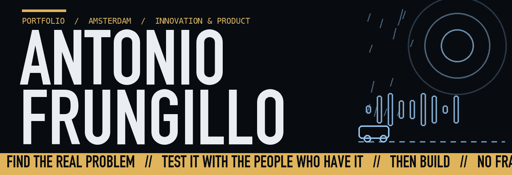

### I START WHERE THERE IS NO PRODUCT YET.

Find the real problem. Test it with the people who have it. Then build something that works.
Product design, human-computer interaction and lean engineering, for the people standard software forgets.

[**PORTFOLIO**](https://antoniotakor-tech.github.io) · [**LINKEDIN**](https://www.linkedin.com/in/antonio-frungillo) · [**EMAIL**](mailto:antoniotakor@icloud.com)

---

### WORK

| | | |
| :--- | :--- | :--- |
| **CALM NAVIGATION COMPANION** | Walking navigation that routes for calm instead of speed. Installable PWA, no account, no framework. | [Live](https://calm-navigation-companion.pages.dev) · [Code](https://github.com/antoniotakor-tech/calm-navigation-companion) |
| **MILEZERO** | Is this ride worth it? A red or green answer for gig drivers, built on 50 driver interviews. Team project (4mobility). | [Live](https://antoniotakor-tech.github.io/milezero-site/) · [Code](https://github.com/antoniotakor-tech/milezero-site) |
| **SPAAKWERK** | A landing page for a bike shop: prices first, WhatsApp booking, zero cookies. A practice client job. | [Live](https://antoniotakor-tech.github.io/spaakwerk-demo/) · [Code](https://github.com/antoniotakor-tech/spaakwerk-demo) |
| **THE RETURN GAP** | A costed pilot for urban waste collection, from field research and street interviews. | [Portfolio](https://antoniotakor-tech.github.io) |
| **PURYLOCK** | A modular lobby concept for a brand partner, decided with Stars and Dogs and COCD matrices. | [Portfolio](https://antoniotakor-tech.github.io) |
| **GRANDPOD** | A concept test for older people: human first, AI backstage. | [Portfolio](https://antoniotakor-tech.github.io) |

### RULES

- **NO FRAMEWORKS.** Plain HTML, CSS and vanilla JavaScript that one person can still fix in ten years.
- **NO TRACKERS.** No analytics, no third-party requests, self-hosted fonts, a strict security policy.
- **NO FAKE EVIDENCE.** Simulated proof does not count. 26 stages of Double Diamond before anything gets built.
- **NO GUESSING.** Phone width first. Contrast computed. Keyboard and reduced motion respected.

### STACK

`Vanilla JS` `CSS` `PWA` `Service Workers` `Cloudflare Pages + D1` `GitHub Pages` `Capacitor` `MapLibre GL` `Web Audio` `Git`

---

BA Business Innovation, Inholland Amsterdam · Italiano (madrelingua) · English (fluent) · Nederlands (developing)
