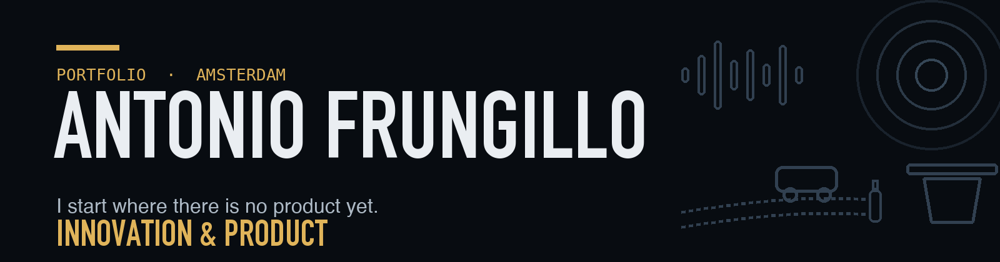

I find the real problem, test it with the people who have it, and then build something that works. I work where product design, human-computer interaction and lean engineering meet, and I like tools for people that standard "efficient" software leaves out.

[Portfolio](https://antoniotakor-tech.github.io) · [LinkedIn](https://www.linkedin.com/in/antonio-frungillo) · [Email](mailto:antoniotakor@icloud.com)

---

## Work

| Project | What it is | Link |
| :--- | :--- | :--- |
| **Calm Navigation Companion** | A walking navigation PWA that routes for calm instead of speed. Plain HTML, CSS and JavaScript, no framework, no account. | [Live app](https://calm-navigation-companion.pages.dev) · [Code](https://github.com/antoniotakor-tech/calm-navigation-companion) |
| **MileZero** | Team project (4mobility): a ride-value check for gig drivers, built on 50 driver interviews. Landing page with privacy statement and cookie policy. | [Website](https://antoniotakor-tech.github.io/milezero-site/) · [Code](https://github.com/antoniotakor-tech/milezero-site) |
| **Spaakwerk landing page** | A landing page for a small bike shop, built as a practice client job. Fixed prices up front, WhatsApp booking, no cookies, strict security policy. | [Live](https://antoniotakor-tech.github.io/spaakwerk-demo/) · [Code](https://github.com/antoniotakor-tech/spaakwerk-demo) |
| **The Return Gap** | A costed pilot for urban waste collection, based on field research and street interviews. | [Portfolio](https://antoniotakor-tech.github.io) |
| **Purylock** | A modular lobby concept for a brand partner, decided with Stars and Dogs and COCD matrices. | [Portfolio](https://antoniotakor-tech.github.io) |
| **GrandPod** | A browser MVP and a Wizard-of-Oz concept test for older people: human first, AI backstage. | [Portfolio](https://antoniotakor-tech.github.io) |

## How I build

- **Plain web.** HTML, CSS and vanilla JavaScript. No bundlers, no frameworks, so one person can keep it running years from now.
- **Quiet by default.** No analytics, no trackers, no third-party requests, self-hosted fonts, a strict content security policy.
- **Evidence before build.** I use my own 26-stage Double Diamond process, and simulated evidence does not count.
- **Real people.** Phone width first, keyboard and reduced motion respected, contrast computed and not guessed.

## Stack

Vanilla JS (ES6+) · CSS · PWA and service workers · Cloudflare Pages and D1 · GitHub Pages · Capacitor · MapLibre GL · Web Audio API · Git

## Background

BA Business Innovation, Inholland Amsterdam. Italian (native), English (fluent), Dutch (developing).
